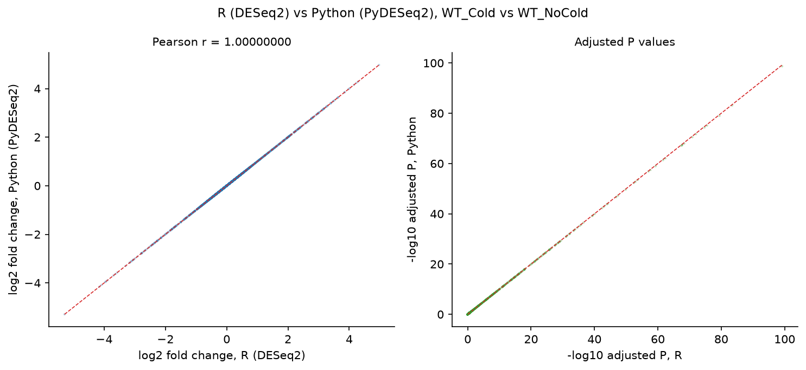

# RNA-CrossCheck

The same RNA-seq differential expression analysis, implemented twice -
once in R (DESeq2) and once in Python (PyDESeq2) - and checked against
each other gene by gene.

## Why

Two independent implementations of one analysis should agree. Where they
do not, one of them is wrong. This repository makes that check explicit,
quantitative and reproducible, rather than assuming two tools that claim
to do the same thing actually do.

## Result

| Quantity | Agreement |
|---|---|
| Genes passing the pre-filter | 5,857 of 6,000 in both |
| log2 fold change | Pearson r = 0.9999999995, max difference 2.6e-04 |
| Base mean | Pearson r = 1.0000000000, max difference 5.5e-11 |
| -log10 adjusted P | Pearson r = 0.9999992404 |
| Size factors | identical to 4e-15 (machine precision) |
| PCA, PC1 and PC2 | Pearson r = 1.0000000000, max difference 7e-14 |
| Genes called at padj < 0.05 | 426 in both, 0 called by only one |

The two implementations agree on every gene call. The residual
differences in log2 fold change come from the iterative fit converging to
slightly different points, not from a difference in method.

## Data

Simulated counts from `make_demo_rnaseq()` in PhytoOmics Studio: 6,000
Arabidopsis genes, 2 genotypes x 2 treatments x 3 replicates, negative
binomial with a known ground truth and a fixed seed. No measured data is
used, so this repository can stay public and anyone can rerun it.

Contrast tested: WT_Cold vs WT_NoCold, design `~ group`, pre-filter of at
least 10 reads in at least 3 samples.

## Layout

    export_reference.R        R side: simulate, run DESeq2, VST and PCA
    data/r_reference/         the R output Python has to reproduce
    01_load_and_filter.py     load counts, reproduce the pre-filter
    02_size_factors.py        median-of-ratios size factors, written out by hand
    03_deseq_python.py        differential expression with PyDESeq2
    04_compare.py             gene-by-gene comparison and the scatter plots
    05_plots_and_pca.py       volcano, PCA, and the PCA cross-check
    results/                  figures and the Python results table

`02_size_factors.py` implements the normalisation from the definition
instead of calling a library, so the step can be checked against DESeq2
independently of PyDESeq2.

## Running it

    Rscript export_reference.R

    python -m venv .venv
    .venv/Scripts/pip install pandas numpy matplotlib scipy pydeseq2
    .venv/Scripts/python 01_load_and_filter.py
    .venv/Scripts/python 02_size_factors.py
    .venv/Scripts/python 03_deseq_python.py
    .venv/Scripts/python 04_compare.py
    .venv/Scripts/python 05_plots_and_pca.py

Tested with R 4.5.2 / DESeq2 1.50.2 and Python 3.12.10 / PyDESeq2 0.7.0.
